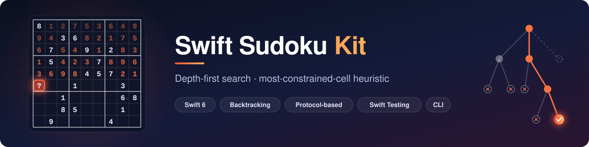

<p align="center">
  
</p>

[](https://github.com/tkausch/swift-sudoku-solver/actions/workflows/tests.yml)
[](https://swift.org)
[](#requirements)
[](https://swift.org/package-manager/)
[](https://github.com/tkausch/swift-sudoku-solver/tags)
[](LICENSE)
[](https://github.com/tkausch/swift-sudoku-solver/commits/main)

A 9×9 Sudoku library and command-line tool in Swift. It solves any valid puzzle,
from newspaper-easy to grids designed to defeat computers, and generates new easy
puzzles with exactly one solution.

The code is small and documented, so it also works as a readable example of
backtracking search, constraint checking and puzzle generation in modern Swift.

## Features

- **Solve any puzzle:** depth-first search that always branches on the cell with the
  fewest candidates. Even the hardest built-in puzzle solves in about half a second.
- **Solve like a human:** `NakedSingleSolver` only fills cells that have one possible
  digit and tells you when it gets stuck, which is a simple measure of difficulty.
- **Check uniqueness:** `countSolutions(_:limit:)` tells you whether a puzzle has
  zero, one or several solutions.
- **Generate puzzles:** random easy puzzles with symmetric clues, reproducible with
  your own random number generator.
- **Extensible:** solvers work with any grid that adopts `SolvableSudoku`, for example
  a 4×4 variant, and new algorithms can adopt the `SudokuSolver` protocol.
- **12 famous puzzles built in,** from the Wikipedia example to AI Escargot and Easter Monster.

## Requirements

Swift 6.0+, macOS 13+ / iOS 16+. The library has no dependencies; the command-line
tool uses [Swift Argument Parser](https://github.com/apple/swift-argument-parser).
Tests run on Linux with Swift 6.0 in GitHub Actions.

## Installation

Add the package to your `Package.swift`:

```swift
dependencies: [
    .package(url: "https://github.com/tkausch/swift-sudoku-solver.git", branch: "main"),
],
targets: [
    .target(name: "MyApp", dependencies: [
        .product(name: "SudokuKit", package: "swift-sudoku-solver"),
    ]),
]
```

In Xcode, choose **File → Add Package Dependencies…** and enter the repository URL.

## Command-line tool

```sh
swift build -c release
.build/release/sudoku                    # solve a random built-in puzzle
.build/release/sudoku --sample 12        # solve built-in puzzle 12 (see --list)
.build/release/sudoku 53..7....6..195....98....6.8...6...34..8.3..17...2...6.6....28....419..5....8..79
.build/release/sudoku --generate         # generate an easy puzzle and solve it
.build/release/sudoku -g --clues 30      # ... with at least 30 clues (default 36)
```

Puzzles are 81 cells row by row: digits 1-9, `0` or `.` for empty. The tool prints the
grid, the board positions visited, the time and the solution. Run `sudoku --help` for
all options. Invalid input exits with status 64, an unsolvable puzzle with status 1.

A generated puzzle is also printed as a single line, so you can save it or pass it
back to the solver:

```
$ sudoku --generate
Generated easy puzzle with 36 clues:
.91..3..784521..9..76.9...1.8...2....19...52....6...7.5...2.76..2..369859..5..13.

. 9 1 | . . 3 | . . 7
8 4 5 | 2 1 . | . 9 .
. 7 6 | . 9 . | . . 1
------+-------+------
...

Board positions visited: 46

Solved in 0.2 ms:

2 9 1 | 4 6 3 | 8 5 7
...
```

## Library

```swift
import SudokuKit

let puzzle = Sudoku(grid: cells)!                  // 81 values, 0 = empty
let solution = DFSSolver().solve(puzzle)            // nil if unsolvable
let isUnique = DFSSolver().countSolutions(puzzle) == 1
let easy = SudokuGenerator().generateEasy()         // pass `using: &rng` to make it reproducible
```

| Type | Purpose |
|---|---|
| `Sudoku` | 9×9 grid; creation fails for invalid input. `subscript(row:col:)`, `candidates(atRow:col:)`, `isValidSudoku()`, `isComplete`. |
| `SolvableSudoku` | What a solver needs from a grid. Adopt it to solve other sizes (e.g. 4×4). |
| `SudokuSolver` | Protocol for solving algorithms: `solve(_:) -> Puzzle?`. |
| `DFSSolver` | Backtracking solver; also `solveCountingPositions(_:)` and `countSolutions(_:limit:)`. |
| `NakedSingleSolver` | Fills only cells with exactly one candidate, never guesses. Reports `solved`, `stuck` or `contradiction`. |
| `SudokuGenerator` | `generateEasy(minimumClues:)`: puzzles solvable with naked singles alone. |

## How it works

**Solving:** `DFSSolver` picks the empty cell with the fewest candidates, tries each
digit and recurses, and backtracks on dead ends. Choosing the most constrained cell
finds dead ends early and fills forced cells without guessing.

**Generating:** `SudokuGenerator` fills a random complete grid, then empties cell pairs
that mirror each other through the center, in random order. A pair stays empty only if
`NakedSingleSolver` can still solve the puzzle. Because every digit is then forced, the
puzzle has exactly one solution.

## Results

Release build, median of 5 runs, Apple M3 Pro, Swift 6.4. A *board position* is one grid
state examined by the search; a puzzle with `n` empty cells needs at least `n + 1`.

| # | Puzzle | Clues | Positions | Time (ms) |
|--:|---|--:|--:|--:|
| 1 | Wikipedia example (easy) | 30 | 52 | 0.3 |
| 2 | Project Euler #96, grid 01 (easy) | 32 | 50 | 0.3 |
| 3 | Project Euler #96, grid 02 (medium) | 30 | 62 | 0.4 |
| 4 | Peter Norvig, grid 2 (hard) | 17 | 719 | 8.8 |
| 5 | Arto Inkala, "world's hardest" | 21 | 13,811 | 129.9 |
| 6 | Easter Monster | 21 | 6,274 | 40.9 |
| 7 | Golden Nugget | 21 | 14,713 | 103.2 |
| 8 | AI Escargot | 23 | 220 | 1.6 |
| 9 | Peter Norvig, hardest.txt #1 | 22 | 4,876 | 37.2 |
| 10 | Peter Norvig, hardest.txt #2 | 23 | 654 | 4.8 |
| 11 | Peter Norvig, hardest.txt #4 | 24 | 1,517 | 13.0 |
| 12 | Wikipedia, designed against brute force | 17 | 58,234 | 511.8 |

Puzzles 5–12 are very hard for humans, but not always for the solver: AI Escargot needs
only 220 positions. Each position costs about 7–9 µs, mostly for allocating candidates.

## Development

```sh
swift build
swift test
```

## License

Copyright © 2026 Thomas Kausch. Licensed under the [Apache License, Version 2.0](LICENSE).
